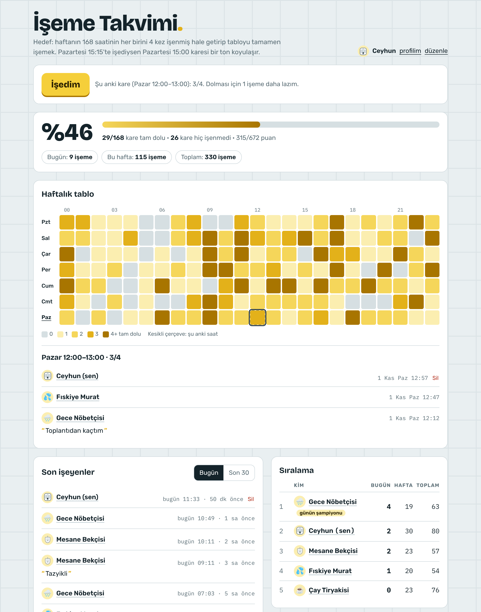
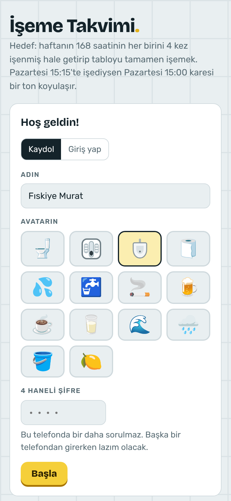
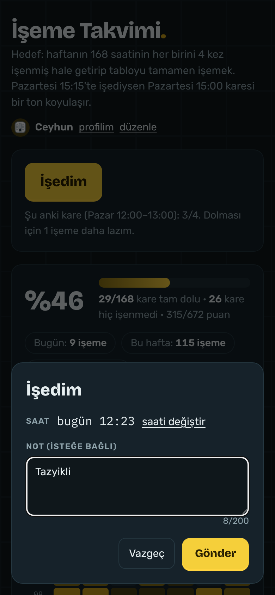
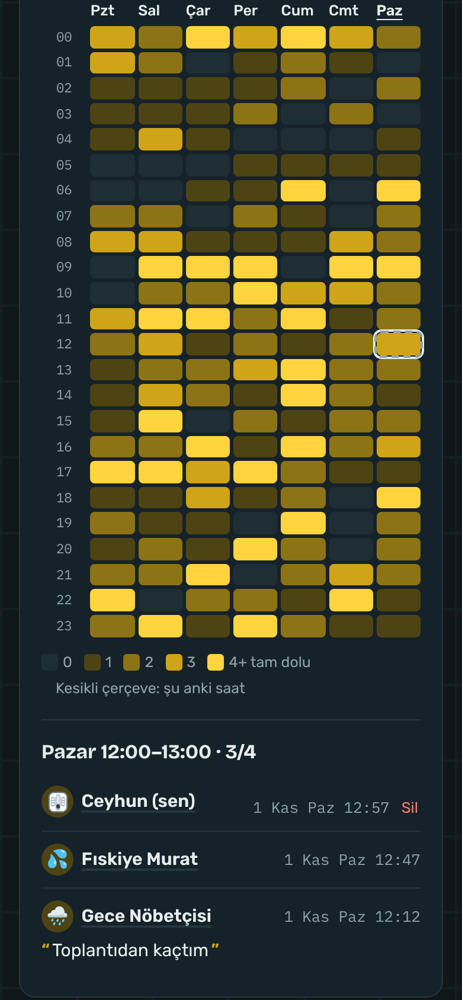
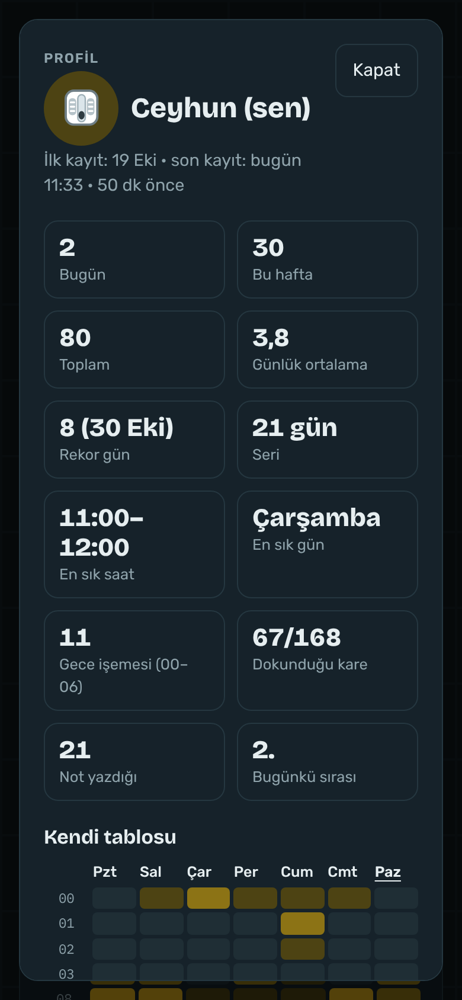

# 🚽 İşeme Takvimi

> Bilimin henüz sormadığı soruya cevap: **Salı gecesi 04:00'te kim işiyor?**

Arkadaşlarla birlikte oynanan, tamamen gereksiz ama fazlasıyla bağımlılık yapan bir web uygulaması. Hedef basit: haftanın **168 saatinin** her birini **4 kez** işenmiş hale getirip tabloyu tamamen koyulaştırmak.

GitHub'daki yeşil katkı tablosunu dolduranlar bilir. Bu onun sarısı.



## Nasıl oynanır?

1. Siteye gir, adını yaz, kendine bir avatar seç (alaturka tuvaletten pisuvara, zengin bir koleksiyon).
2. İşedin mi? **İşedim**'e bas. İstersen bir not düş: *"Tazyikli"*, *"Maç arasında yetiştim"*, *"Gece 4'te kalktım, kare benim"*.
3. Pazartesi 15:15'te işediysen **Pazartesi 15:00** karesi bir ton koyulaşır.
4. Bir kare 4 kez işenince tam dolar. Bütün kareler dolunca... şimdilik bir şey olmuyor. Ama gururlu olursun.

En zor kareler, tahmin edeceğin gibi, gece 03:00 ile 06:00 arası. Ekipte bir gece kuşu olması stratejik bir avantajdır.

## Özellikler

- **Haftalık tablo:** 7 gün × 24 saat. Kareye dokun, o saatte kimin, ne zaman, hangi notla işediğini gör.
- **Puan ve ilerleme:** 672 puan üzerinden ortak ilerleme, tam dolu ve hiç işenmemiş kare sayıları.
- **Son işeyenler:** Bugünün ve son 30 kaydın akışı, notlarıyla birlikte.
- **Sıralama:** Bugün, bu hafta ve tüm zamanlar. Günün en çok işeyeni **günün şampiyonu** unvanını alır.
- **Profiller:** Günlük ortalama, rekor gün, kaç gündür seri bozmadığın, en sık işediğin saat ve gün, gece işemeleri ve kendi kişisel tablon.
- **4 haneli şifreyle giriş:** Aynı telefonda bir daha sorulmaz, başka telefondan girerken sorulur. Kimse senin adına işeyemez.
- **Yönetici modu:** Kayıt düzenleme, silme, şifre sıfırlama. Spam yapan arkadaşlar için birebir.
- **Telefona göre tasarlandı:** Ana ekrana ekleyince uygulama gibi açılır. Koyu tema da var.

<table>
  <tr>
    <td></td>
    <td></td>
    <td></td>
    <td></td>
  </tr>
  <tr>
    <td align="center">Kaydol</td>
    <td align="center">İşedim</td>
    <td align="center">Tablo (koyu tema)</td>
    <td align="center">Profil</td>
  </tr>
</table>

*Ekran görüntülerindeki isimler ve kayıtlar uydurmadır. Hiçbir mesane zarar görmemiştir.*

## Sıkça sorulan sorular

**Bu bir şaka mı?**
Evet. Ama veritabanı gayet ciddi.

**Neden 4 kez?**
1 kez çok kolaydı, 10 kez insanlık dışıydı. 4 tam kıvamında.

**Verilerim güvende mi?**
Kayıtlara sadece giriş yapmış kişiler ulaşabiliyor. Herkes yalnızca kendi kaydını ekleyip silebiliyor ve bu kurallar sitede değil veritabanında kontrol ediliyor. Şifreler veritabanında okunamaz şekilde (bcrypt) saklanıyor. 5 yanlış denemede profil 15 dakika, 10 yanlış denemede 24 saat kilitleniyor. Yine de bu bir arkadaş grubu oyunu, banka değil.

**Canlı bir sürümü var mı?**
Var ama arkadaş grubuna özel. Kendininkini kurmak 10 dakika, aşağıda anlatılıyor.

## Kendin kur

Her şey ücretsiz planlarla çalışıyor. Sunucu kodu yok: site tek bir HTML dosyası, bütün kurallar veritabanı fonksiyonlarında.

1. **Depoyu forkla.**
2. **Supabase:** [supabase.com](https://supabase.com)'da ücretsiz bir proje aç. **SQL Editor**'de [`supabase.sql`](supabase.sql) dosyasının içeriğini çalıştır.
3. **Ayarlar:** Supabase'de **Project Settings → API** sayfasındaki proje adresini ve `publishable` (anon) anahtarını [`index.html`](index.html) içindeki `SUPABASE_URL` ve `SUPABASE_ANON_KEY` satırlarına yaz. Bu anahtar herkese açık olmak için tasarlanmış, gizli değil. `service_role` ya da `sb_secret_` ile başlayan anahtarı asla siteye koyma.
4. **Vercel:** [vercel.com](https://vercel.com)'da **Add New → Project** ile forkladığın depoyu seç, hiçbir ayara dokunmadan **Deploy** de.
5. **Kendini yönetici yap:** Sitede kaydolduktan sonra Supabase SQL Editor'de şunu çalıştır:

   ```sql
   insert into public.admins (player_id)
   select id from public.players where nick = 'Senin adın';
   ```

6. Linki arkadaşlarına at ve sıvı tüketimini artır.

> Türkiye'de bazı mobil operatörler `vercel.app` adreslerini açmayabiliyor. Wi-Fi'da çalışıp mobil veride açılmıyorsa sorun büyük ihtimalle bu. Kendi alan adını Vercel'e bağlamak çözüm olabilir.

## Nasıl çalışıyor?

| Parça | Ne kullanıldı |
| --- | --- |
| Site | Tek bir `index.html`, framework yok |
| Veritabanı | Supabase (PostgreSQL) |
| Kurallar | Satır düzeyinde güvenlik ve `security definer` fonksiyonları |
| Giriş | Cihaz anahtarı + 4 haneli şifre (bcrypt) |
| Yenileme | Site açıkken 30 saniyede bir, yalnızca değişiklikler çekilir |
| Yayın | Vercel |

Veri trafiği bilerek düşük tutuldu: kayıtlar telefonda saklanıyor, sunucudan sadece son kontrolden sonraki eklemeler ve silmeler isteniyor. Değişiklik yokken bir yenileme yaklaşık 300 bayt.

## Teşekkürler

Bir gece "GitHub tablosu gibi ama işeme için" diye başlayan fikir, [Claude](https://claude.ai) ile birlikte yazıldı. Test sürecinde birçok arkadaş gönüllü olarak işedi. Bazıları fazla gönüllüydü.
